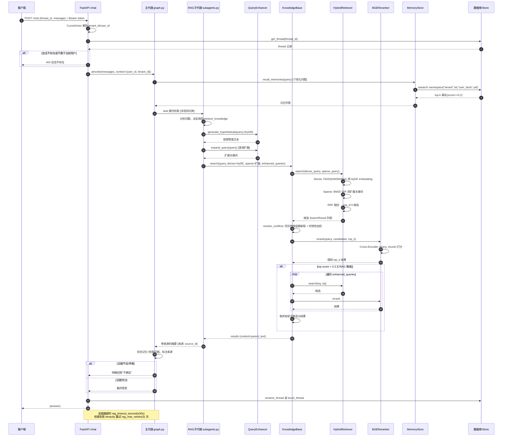

# 项目完整链路（RAG + Wiki + Memory + Multi-tenant）

> 本文档基于当前代码库实际实现，所有节点均标注源码位置，可核验。
> 最后更新：2026-10-19

---

## 一、全局架构

```
┌──────────────────────────────────────────────────────────────────────┐
│                        FastAPI 应用层 (src/api/)                       │
│  ┌─────────┐ ┌──────────┐ ┌──────────┐ ┌─────────┐ ┌────────┐       │
│  │  auth   │ │ threads  │ │ memory   │ │  wiki   │ │ admin  │       │
│  │ /auth/* │ │ /threads │ │ /memory  │ │ /wiki   │ │/admin  │       │
│  └────┬────┘ └────┬─────┘ └────┬─────┘ └────┬────┘ └───┬────┘       │
│       │           │            │            │          │            │
│  /chat │           │            │            │          │            │
│       ▼           ▼            ▼            ▼          ▼            │
│  ┌────────────────────────────────────────────────────────────────┐  │
│  │              DeepAgents 主代理 (src/agents/graph.py)            │  │
│  │   规划 + 协调 + 综合答案，不直接持有检索工具                       │  │
│  └────────┬───────────────────────────────┬───────────────────────┘  │
│           │ task 委托                      │ 挂载记忆工具            │
│           ▼                               ▼                        │
│  ┌─────────────────────┐     ┌──────────────────────────┐           │
│  │ RAG 子代理           │     │ 语义事实记忆三件套         │           │
│  │ rag_retriever       │     │ save/recall/forget       │           │
│  │ (src/agents/        │     │ (src/memory/tools.py)    │           │
│  │  subagents.py)      │     └────────────┬─────────────┘           │
│  └──────────┬──────────┘                  │                         │
│             │ retrieve_knowledge          │ scan_secret / 配额 / TTL│
│             ▼                             ▼                         │
│  ┌──────────────────────────────────────────────────────┐           │
│  │              RAG 检索引擎 (src/rag/)                  │           │
│  │  QueryEnhancer → HybridRetriever → Reranker → CRAG   │           │
│  └──────────────────────────────────────────────────────┘           │
└──────────────────────────────────────────────────────────────────────┘
           │                              │
           ▼                              ▼
┌─────────────────────┐      ┌──────────────────────────┐
│ 持久化层             │      │ 文件系统                  │
│ src/persistence/     │      │ data/knowledge/<tenant>/ │
│ database.py          │      │  ├─ wiki/<slug>.md       │
│  tenants/users/      │      │  └─ <uploaded files>     │
│  threads/            │      └──────────────────────────┘
│  wiki_pages/         │
│  wiki_revisions/     │
│  + LangGraph Store   │
│    (checkpointer)    │
└─────────────────────┘
```

---

## 二、请求入口链路

所有 HTTP 请求先经过 FastAPI，认证从 JWT 解析 `tenant_id` + `user_id`，注入运行时 context。

| 端点 | 文件 | 说明 |
|------|------|------|
| `POST /auth/register` | [auth.py](file:///d:/project/Rag/src/api/auth.py) | 注册（受 `allow_registration` 控制） |
| `POST /auth/login` | [auth.py](file:///d:/project/Rag/src/api/auth.py) | 登录，返回 access_token + refresh_token；suspended 租户返回 403 |
| `GET /auth/me` | [auth.py](file:///d:/project/Rag/src/api/auth.py) | 当前用户信息 |
| `POST /threads` | [threads.py](file:///d:/project/Rag/src/api/threads.py) | 创建会话 |
| `POST /chat` | [app.py:434](file:///d:/project/Rag/src/api/app.py#L434-L489) | 对话入口，驱动主代理 |
| `POST /knowledge/upload` | [app.py:210](file:///d:/project/Rag/src/api/app.py#L210-L321) | 上传知识库文档 |
| `POST /wiki/pages` | [wiki.py:146](file:///d:/project/Rag/src/api/wiki.py#L146) | 创建 Wiki 页面 |
| `POST /memory/fact` | [memory.py](file:///d:/project/Rag/src/api/memory.py) | 写入语义事实记忆 |

**认证机制**：`auth.CurrentUser` 依赖从 `Authorization: Bearer <jwt>` 解析出用户字典（含 `tenant_id`, `role`, `id`）。平台管理端点额外由 `require_platform_admin` 守护（非 platform_admin 返回 403）。

---

## 三、对话问答链路（核心）

```
POST /chat
    │
    ▼
[app.py:444] 校验会话归属（thread.user_id == user.id）
    │
    ▼
[app.py:458] agent.ainvoke(context={user_id, tenant_id})
    │
    ▼
主代理 (src/agents/graph.py build_agent)
    │  system_prompt: 必须标注来源，不确定说不确定
    │
    ├─ 涉及知识库 → task 委托 rag_retriever 子代理
    │       │
    │       ▼
    │   RAG 子代理 (subagents.py:15)
    │       │  system_prompt: 只检索不决策，必须引用来源
    │       │  tools: [retrieve_knowledge]
    │       │
    │       ▼
    │   retrieve_knowledge (rag/tools.py:101)
    │       │  tenant_id = get_runtime().context.tenant_id
    │       │  带 tenacity 重试 + anyio 超时
    │       │
    │       ▼
    │   _search_with_timeout (rag/tools.py:65)
    │       │
    │       ├─ QueryEnhancer (rag/query_enhancer.py)
    │       │     ├─ generate_hypothetical() → HyDE 假想答案（Dense 用）
    │       │     └─ expand_query() → 扩展关键词（Sparse 用）
    │       │
    │       ▼
    │   KnowledgeBase.search (rag/pipeline.py:145)
    │       │
    │       ├─ HybridRetriever.search (rag/retrieval.py:249)
    │       │     ├─ Dense: FAISS (HNSW≥5000 / Flat<5000) 用 HyDE embedding
    │       │     ├─ Sparse: BM25 分片 用扩展关键词
    │       │     └─ RRF 融合 → top_k*4 候选
    │       │
    │       ├─ resolve_conflicts (rag/retrieval.py:84)
    │       │     └─ 同文档族只留最新版 + 时效性加权
    │       │        (current×1.10, unknown×1.0, future×0.85, expired×0.60)
    │       │
    │       ├─ BGEReranker.rerank (rag/reranker.py:45)
    │       │     └─ Cross-Encoder 精排 top_k*4 → top_k
    │       │
    │       └─ CRAG 自我纠正 (pipeline.py:179-199)
    │             └─ top score < 0.3 → 用 enhanced_queries 重试，取最佳
    │       │
    │       ▼
    │   返回 content=parent_text（父子分块，整章上下文）
    │
    ├─ 涉及个性化 → recall_memories (memory/tools.py:352)
    │       │  namespace = ("tenant", tenant_id, "user_facts", user_id)
    │       │  语义召回低于 memory_recall_min_score(0.2) 丢弃
    │       │
    └─ 综合答案 → 标注 [来源: source_id] → 返回用户
```

**父子分块**（[chunking.py:58-118](file:///d:/project/Rag/src/rag/chunking.py#L58-L118)）：
- 子块 `chunk.text`（默认 400 字符）→ embedding / BM25 / 重排打分
- 父块 `metadata["parent_text"]`（整章节含标题路径）→ 返回给 LLM

### 3.1 时序图



**关键节点说明**：

| 步骤 | 源码位置 | 作用 |
|------|----------|------|
| 1-4 | [app.py:434-449](file:///d:/project/Rag/src/api/app.py#L434-L449) | 认证 + 会话归属校验，杜绝越权 |
| 5 | [app.py:458-463](file:///d:/project/Rag/src/api/app.py#L458-L463) | `context` 注入驱动租户/用户隔离 |
| 6-8 | [memory/tools.py:352](file:///d:/project/Rag/src/memory/tools.py#L352) | 语义事实记忆召回，score<0.2 丢弃 |
| 9-14 | [tools.py:79-89](file:///d:/project/Rag/src/rag/tools.py#L79-L89) | HyDE 假想答案 + 查询扩展，LLM 不可用降级原查询 |
| 15-17 | [retrieval.py:249-279](file:///d:/project/Rag/src/rag/retrieval.py#L249-L279) | Dense 用 HyDE，Sparse 用扩展词，RRF 融合 |
| 18 | [retrieval.py:84-130](file:///d:/project/Rag/src/rag/retrieval.py#L84-L130) | 版本冲突过滤 + 时效性加权 |
| 19-20 | [reranker.py:45](file:///d:/project/Rag/src/rag/reranker.py#L45) | Cross-Encoder 精排 |
| 21-23 | [pipeline.py:179-199](file:///d:/project/Rag/src/rag/pipeline.py#L179-L199) | CRAG：低分自动重试增强查询 |
| 24 | [models.py:42-59](file:///d:/project/Rag/src/rag/models.py#L42-L59) | 返回 `content=parent_text`（整章上下文）|
| 25-26 | [subagents.py:15](file:///d:/project/Rag/src/agents/subagents.py#L15) | 子代理只检索不决策，来源交主代理 |
| 异常 | [app.py:464-466](file:///d:/project/Rag/src/api/app.py#L464-L466) | 代理执行失败 → 502 |

---

## 四、知识库入库链路

### 4.1 文件上传

```
POST /knowledge/upload
    │
    ▼
[app.py:228] _sanitize_name 防路径穿越
    │
    ▼
[app.py:233] 格式白名单 .txt/.md/.html/.pdf/.docx
    │
    ▼
[app.py:259] 租户配额校验 max_storage_mb
    │
    ▼
[app.py:281] 落盘 data/knowledge/<tenant_id>/[subdir/]<file>
    │
    ▼
[app.py:298] 若 KB 已初始化 → _refresh_knowledge_base 增量刷新
```

### 4.2 Wiki 页面

```
POST /wiki/pages
    │
    ▼
[wiki.py:150] _validate_slug（小写+数字+连字符）
    │
    ▼
[database.py:1137] create_wiki_page
    │   INSERT wiki_pages + wiki_revisions（append-only 版本日志）
    │
    ▼
[wiki.py:162] _sync_to_knowledge
    │   写入 data/knowledge/<tenant>/wiki/<slug>.md
    │   格式：# {title}\n\n{content}
    │
    ▼
[wiki.py:163] _refresh_if_initialized → 增量 refresh
```

**版本历史**：`wiki_revisions` 表 append-only，`get_wiki_page` 取 `ORDER BY created_at DESC LIMIT 1`，删除页面时 `ON DELETE CASCADE` 级联清版本。

### 4.3 增量索引刷新（KnowledgeBase.refresh）

```
[pipeline.py:74] refresh()
    │
    ├─ scan_document_stats(root) → {source_id: (mtime, size)}
    │
    ├─ 清单完全一致 → 直接返回（毫秒级）
    │
    ├─ 变更文件 → load_document + chunk_document（父子分块）
    ├─ 删除文件 → _doc_chunks.pop
    │
    ├─ CachedCorpusEmbedder.embed_corpus（命中缓存跳过嵌入）
    ├─ prune 过期缓存
    │
    └─ HybridRetriever（FAISS + BM25 分片重建）
```

---

## 五、记忆链路

```
save_memory(text, category, ttl_days)     [memory/tools.py:333]
    │
    ├─ scan_secret(content) [guard.py:47] → 疑似密钥直接拒绝
    ├─ 配额校验 max_facts / 单条长度上限
    ├─ 语义去重（相似度 > 阈值不重复写入）
    ├─ 写入 Store namespace = ("tenant", tenant_id, "user_facts", user_id)
    └─ TTL 绝对语义（refresh_on_read=False），后台 sweeper 物理删除

recall_memories(query, k)                [memory/tools.py:352]
    │
    ├─ 语义向量检索 user_facts namespace
    ├─ 分数 < memory_recall_min_score(0.2) 视为噪声丢弃
    └─ 返回 top-k 事实

forget_memory(memory_id)                  [memory/tools.py:365]
    │
    └─ 从 user_facts namespace 删除单条
```

**画像记忆**（`/memory/AGENTS.md`）：通过 StoreBackend 的 `edit_file` 维护，namespace 为 `("tenant", tenant_id, "user_memory", user_id)`，与事实记忆分开顶级 namespace 避免前缀搜索污染。

---

## 六、多租户隔离链路

每一层显式带 `tenant_id`：

| 层 | 隔离机制 |
|----|----------|
| API 认证 | JWT 解析 `tenant_id`，`CurrentUser` 注入 |
| 业务表 | `WHERE tenant_id = ?`，`UNIQUE(tenant_id, slug)` |
| 知识库 | `data/knowledge/<tenant_id>/` 目录 + `_KB_CACHE[tenant_id]` 单例 |
| 记忆 Store | namespace 前缀 `("tenant", tenant_id, "user_memory"/"user_facts", user_id)` |
| 平台管理 | `/api/admin/*` 由 `require_platform_admin` 守护 |
| 默认租户 | `default` 租户不可删除；`status=suspended` 登录返回 403 |

跨租户数据严格不可见：即使知道别租户 slug，`get_wiki_page(other_tenant, slug)` 返回 None → 404。

---

## 七、运维与评估链路

| 命令 | 说明 |
|------|------|
| `pytest tests/ -v` | 全量测试 |
| `python -m src.eval.run` | RAGAS 检索评估 |
| `python -m src.eval.run_memory --mode both` | 记忆无 LLM 评估（hash/none 双模式） |
| `python scripts/stress_memory.py` | 记忆层并发压测 |
| `python scripts/backup_postgres.py` | PG 逻辑备份 |
| `python scripts/backup_postgres.py --mode base` | PG PITR 基准备份 |
| `python scripts/migrate_single_to_multi_tenant.py` | 单→多租户迁移 |

**红线约束**（来自 AGENTS.md）：
- 记忆工具 user_id 必须从 `get_runtime().context` 获取，禁止参数传入
- 记忆写入必须经 `scan_secret` 凭据扫描
- TTL 采用绝对语义（`refresh_on_read=False`），sweeper 不可关闭
- 子代理 system_prompt 必须明确"只检索不决策"
- 主代理 system_prompt 必须包含"检索结果标注来源，不确定说不确定"
- 所有工具必须有超时 + 失败重试
- Store namespace 必须以 `("tenant", tenant_id, ...)` 开头

---

## 八、技术栈

| 组件 | 选型 |
|------|------|
| 框架 | FastAPI + uvicorn |
| 代理编排 | DeepAgents (`create_deep_agent`) + LangGraph |
| 嵌入模型 | bge-m3（稠密+稀疏双路径）|
| 重排序 | bge-reranker-v2-m3（Cross-Encoder）|
| 向量索引 | FAISS（HNSW≥5000 / Flat<5000）|
| 稀疏检索 | BM25Okapi 分片 |
| 持久化 | SQLite / Postgres（业务+checkpointer+Store）|
| 评估 | RAGAS |
| 可观测性 | LangSmith |
