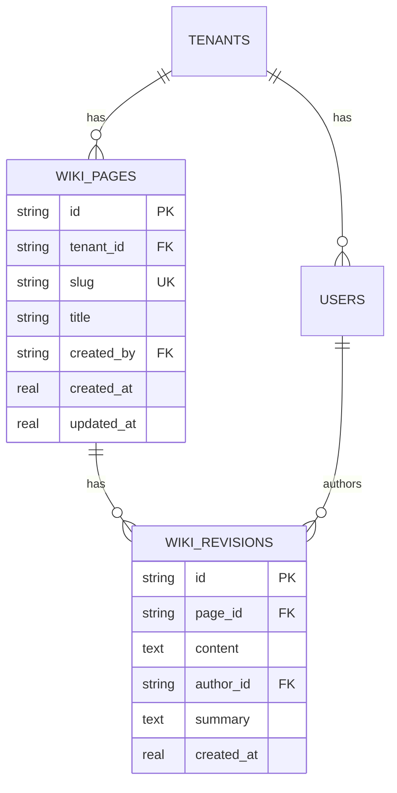
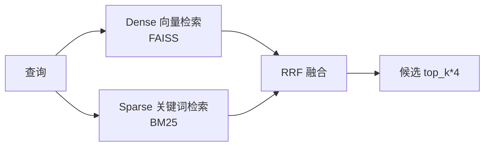
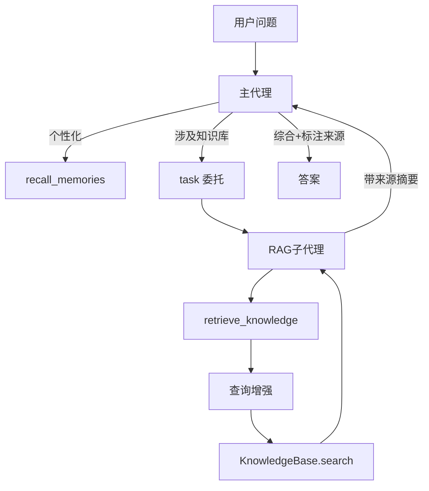
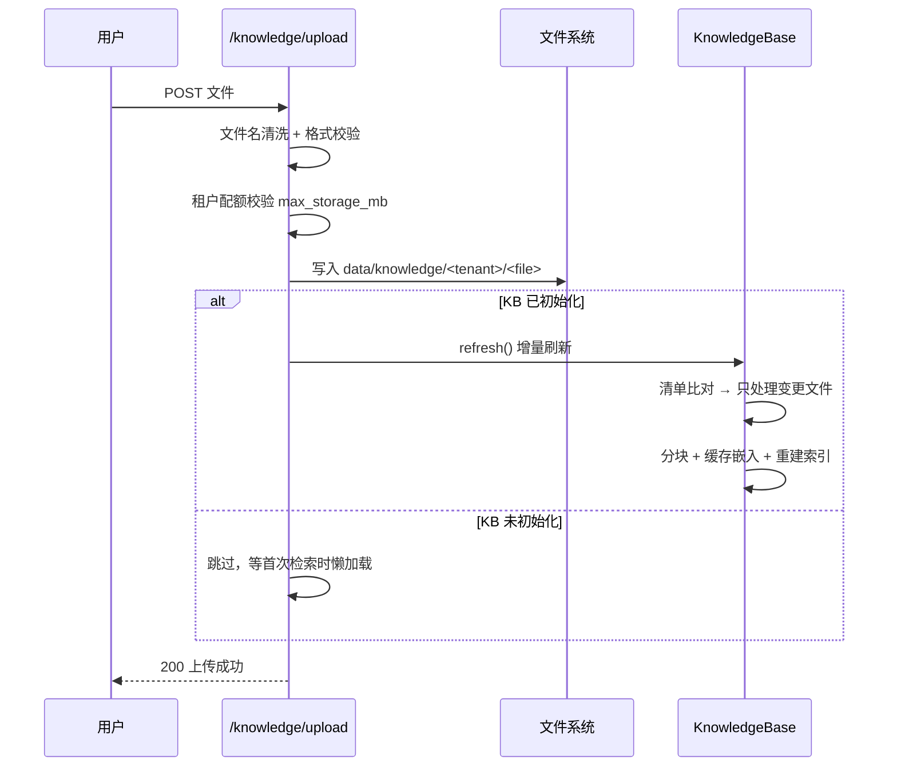
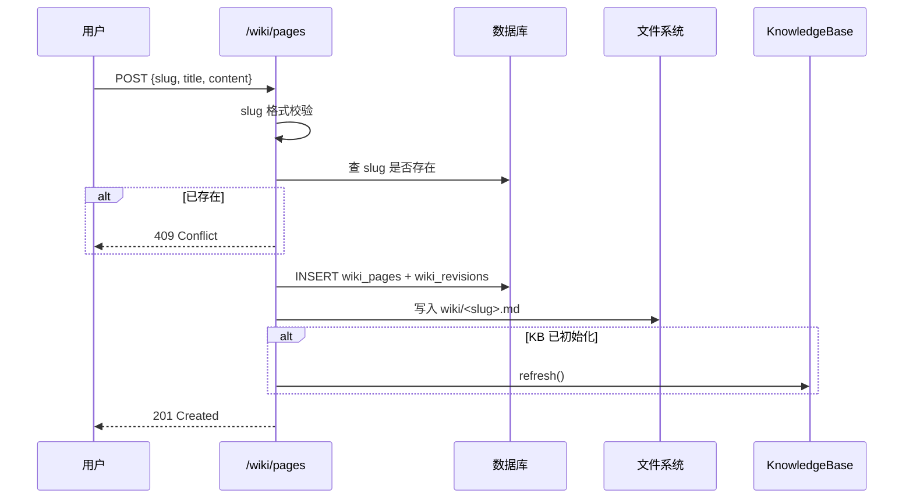
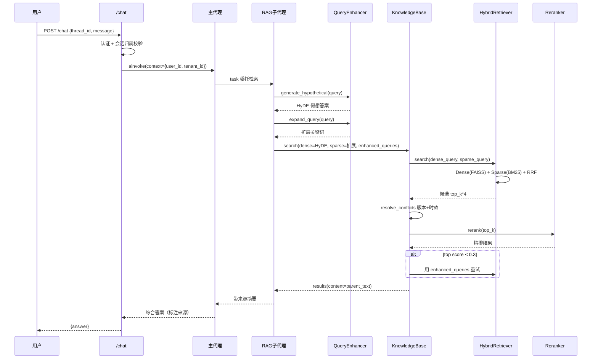

# Wiki + RAG 架构设计文档

> 版本：v1.0 | 日期：2026-10-19
> 适用范围：`d:\project\Rag` 项目的 Wiki 与 RAG 子系统
> 所有模块均标注源码位置，可点击核验。

---

## 1. 文档概述

### 1.1 背景

企业内部知识（政策、规范、产品文档）以文件形式散落，员工查找困难、版本混乱。需要一套系统既能**在线协作撰写**知识，又能通过**自然语言问答**快速获取答案。

### 1.2 设计目标

| 目标 | 说明 |
|------|------|
| 知识可撰写 | Wiki 在线编辑，版本可追溯 |
| 知识可检索 | 自然语言提问，返回带来源的答案 |
| 编辑即生效 | Wiki 改动自动同步到 RAG 索引 |
| 多租户隔离 | 不同租户数据严格不互通 |
| 可扩展 | 支持百万级文档块的毫秒级检索 |

### 1.3 技术栈

- **Web 框架**：FastAPI + uvicorn
- **Agent 编排**：DeepAgents（LangGraph 运行时）
- **嵌入模型**：bge-m3（稠密 + 稀疏双路径）
- **重排序**：bge-reranker-v2-m3（Cross-Encoder）
- **向量索引**：FAISS（HNSW / Flat 自适应）
- **稀疏检索**：BM25Okapi（分片）
- **持久化**：SQLite / Postgres

---

## 2. 整体架构

### 2.1 分层架构图

```mermaid
graph TB
    subgraph 接入层
        U[用户]
    end

    subgraph API层["API 层 src/api/"]
        CHAT[/chat/]
        WIKI[/wiki/*]
        KB[/knowledge/*]
        AUTH[/auth/]
    end

    subgraph Agent层["Agent 编排层 src/agents/"]
        MAIN[主代理<br/>graph.py]
        RAG_SUB[RAG子代理<br/>subagents.py]
        MAIN -- task委托 --> RAG_SUB
    end

    subgraph RAG层["RAG 检索引擎 src/rag/"]
        QE[查询增强<br/>query_enhancer.py]
        PIPE[流水线编排<br/>pipeline.py]
        RET[混合检索<br/>retrieval.py]
        RR[重排序<br/>reranker.py]
        PIPE --> RET --> RR
    end

    subgraph 数据层
        FS[文件系统<br/>data/knowledge/&lt;tenant&gt;/]
        DB[(数据库<br/>wiki_pages/wiki_revisions)]
    end

    U --> CHAT & WIKI & KB & AUTH
    CHAT --> MAIN
    WIKI -.写入镜像.-> FS
    WIKI -.版本记录.-> DB
    KB -.落盘.-> FS
    RAG_SUB -->|retrieve_knowledge| QE
    QE --> PIPE
    FS -.加载分块.-> PIPE
```

### 2.2 模块职责总览

| 模块 | 文件 | 核心职责 |
|------|------|----------|
| Wiki API | [wiki.py](file:///d:/project/Rag/src/api/wiki.py) | Wiki 页面 CRUD + 版本历史 + 同步知识库 |
| Wiki 存储 | [database.py](file:///d:/project/Rag/src/persistence/database.py) | `wiki_pages` + `wiki_revisions` 表 |
| 文档解析 | [parser.py](file:///d:/project/Rag/src/rag/parser.py) | 加载文件 + 提取元数据 |
| 文档分块 | [chunking.py](file:///d:/project/Rag/src/rag/chunking.py) | 结构感知 + 父子分块 |
| 嵌入 | [embeddings.py](file:///d:/project/Rag/src/rag/embeddings.py) | bge-m3 / hash 双实现 |
| 嵌入缓存 | [embedding_cache.py](file:///d:/project/Rag/src/rag/embedding_cache.py) | SQLite 持久化向量 |
| 混合检索 | [retrieval.py](file:///d:/project/Rag/src/rag/retrieval.py) | FAISS + BM25 + RRF + 冲突过滤 |
| 重排序 | [reranker.py](file:///d:/project/Rag/src/rag/reranker.py) | bge-reranker-v2-m3 精排 |
| 查询增强 | [query_enhancer.py](file:///d:/project/Rag/src/rag/query_enhancer.py) | HyDE + 查询扩展 |
| 流水线 | [pipeline.py](file:///d:/project/Rag/src/rag/pipeline.py) | `KnowledgeBase` 统一入口 |
| 检索工具 | [tools.py](file:///d:/project/Rag/src/rag/tools.py) | `retrieve_knowledge` LangChain tool |
| 主代理 | [graph.py](file:///d:/project/Rag/src/agents/graph.py) | DeepAgents 规划 + 协调 |
| RAG 子代理 | [subagents.py](file:///d:/project/Rag/src/agents/subagents.py) | 只读检索 + 摘要 |

---

## 3. 核心模块设计

### 3.1 Wiki 模块

#### 3.1.1 数据模型



**设计要点**：
- `wiki_pages` 只存不变元信息，`wiki_revisions` 存每次编辑的完整内容快照（append-only）
- `UNIQUE(tenant_id, slug)` 保证租户内 slug 唯一
- `ON DELETE CASCADE` 删页面时级联清版本

#### 3.1.2 同步到知识库

每次写操作都同步镜像到文件系统：

```
wiki_pages + wiki_revisions (DB)
        │
        ▼  _sync_to_knowledge()
data/knowledge/<tenant>/wiki/<slug>.md
        │  内容：# {title}\n\n{content}
        ▼  _refresh_if_initialized()
KnowledgeBase.refresh() 增量重建索引
```

**关键代码** [wiki.py:54-80](file:///d:/project/Rag/src/api/wiki.py#L54-L80)：
```python
def _wiki_file_path(tenant_id, slug):
    return tenant_knowledge_root(tenant_id) / "wiki" / f"{slug}.md"

def _sync_to_knowledge(tenant_id, slug, title, content):
    target = _wiki_file_path(tenant_id, slug)
    target.parent.mkdir(parents=True, exist_ok=True)
    target.write_text(f"# {title}\n\n{content}\n", "utf-8")
```

### 3.2 文档处理流水线

#### 3.2.1 入库流程


#### 3.2.2 增量刷新

`KnowledgeBase.refresh()` 维护文件清单 `_doc_manifest: {source_id: (mtime, size)}`：

| 情况 | 处理 |
|------|------|
| 清单完全一致 | 直接返回（毫秒级） |
| 文件变更 | 重新解析 + 分块 + 嵌入 |
| 文件新增 | 只计算新块 |
| 文件删除 | 从 `_doc_chunks` 移除 |

**关键代码** [pipeline.py:74-143](file:///d:/project/Rag/src/rag/pipeline.py#L74-L143)

#### 3.2.3 父子分块

```
章节（parent_text = 整章含标题路径）
  ├─ 子块1（chunk.text = 400字符）→ 用于检索打分
  └─ 子块2（chunk.text = 400字符）→ 用于检索打分
```

- **子块**：`chunk.text`，默认 400 字符，embedding/BM25/重排都用它
- **父块**：`metadata["parent_text"]`，整章节文本，返回给 LLM 做上下文

返回时 `SearchResult.to_dict()` 的 `content` 字段优先用 `parent_text`。

### 3.3 混合检索引擎

#### 3.3.1 双路召回 + RRF 融合



**RRF 公式**（[retrieval.py:272-276](file:///d:/project/Rag/src/rag/retrieval.py#L272-L276)）：
```
score(chunk) = 1/(60 + dense_rank) + 1/(60 + sparse_rank)
```

#### 3.3.2 FAISS 索引自适应

| 块数 | 索引类型 | 特点 |
|------|----------|------|
| < 5000 | `IndexFlatIP` | 精确暴力搜索，零精度损失 |
| ≥ 5000 | `IndexHNSWFlat` | 近似搜索，O(log N)，支撑百万级 |

#### 3.3.3 冲突过滤

同一文档族（如 `policy_v1` / `policy_v2`）只保留最新版本，并按时效性加权：

| 状态 | 加权因子 |
|------|----------|
| current（生效中） | × 1.10 |
| unknown | × 1.00 |
| future（未生效） | × 0.85 |
| expired（已过期） | × 0.60 |

### 3.4 查询增强

`QueryEnhancer`（[query_enhancer.py](file:///d:/project/Rag/src/rag/query_enhancer.py)）在检索前生成两个增强信号：

| 策略 | 用途 | 原理 |
|------|------|------|
| **HyDE** | Dense 检索 | LLM 生成假想答案，用其 embedding 检索（答案语义更接近文档） |
| **查询扩展** | Sparse 检索 | LLM 生成同义词/上位词，提升 BM25 精确匹配 |

降级机制：LLM 不可用时返回原查询，不影响可用性。

### 3.5 CRAG 自我纠正

在 `KnowledgeBase.search()` 中（[pipeline.py:179-199](file:///d:/project/Rag/src/rag/pipeline.py#L179-L199)）：

```
首轮检索 + 重排
    │
    ▼
top score >= 0.3 ?
    ├─ 是 → 返回结果
    └─ 否 → 用 enhanced_queries 逐个重试，取最高分结果
```

### 3.6 Agent 编排



**职责边界**（通过 system_prompt 强制）：
- 主代理：规划、协调、综合答案、标注来源
- RAG 子代理：只检索 + 摘要，不做最终决策，必须引用来源

---

## 4. 交互流程

### 4.1 文档入库流程（文件上传）



### 4.2 Wiki 页面写入流程



### 4.3 检索问答流程



---

## 5. 多租户隔离设计

每一层显式带 `tenant_id`：

| 层 | 隔离机制 |
|----|----------|
| API 认证 | JWT 解析 `tenant_id`，`CurrentUser` 依赖注入 |
| 数据库 | `WHERE tenant_id = ?`，唯一约束含 `tenant_id` |
| 知识库 | `data/knowledge/<tenant_id>/` 目录 + `_KB_CACHE[tenant_id]` 单例 |
| 记忆 Store | namespace 前缀 `("tenant", tenant_id, "user_memory"/"user_facts", user_id)` |
| 平台管理 | `/api/admin/*` 由 `require_platform_admin` 守护 |

**关键约束**：`tenant_id` 和 `user_id` 一律从 `get_runtime().context` 或登录态取，禁止从工具参数传入。

---

## 6. 关键设计决策

| 决策 | 选择 | 理由 |
|------|------|------|
| 规划方式 | TodoList 工具化 | 不引入独立 Planner LLM，零额外调用，自适应 |
| 分块策略 | 父子分块 | 子块精确定位，父块保证上下文完整 |
| 检索策略 | 混合检索 + RRF | 语义 + 关键词互补，无需分数归一化 |
| 索引策略 | FAISS 自适应 | 小规模精确、大规模近似，平衡精度与性能 |
| Wiki 同步 | 文件镜像 | 复用文件系统流水线，不重复造索引逻辑 |
| 版本存储 | append-only | 实现简单可靠，Markdown 体积小可接受 |
| 查询增强 | 工具层生成 | 检索核心保持无 LLM 依赖，可单独测试 |
| 嵌入缓存 | SQLite 持久化 | 重启不重算，key 含模型命名空间防错读 |

---

## 7. 数据模型汇总

### 7.1 RAG 数据结构

| 类 | 字段 | 说明 |
|----|------|------|
| `SourceDocument` | source_id, text, path, metadata | 加载后的原始文档 |
| `Chunk` | chunk_id, source_id, text, start, end, metadata | 分块后的检索单元，metadata 含 parent_text |
| `SearchResult` | chunk, score | 检索结果，to_dict 返回 content=parent_text |

### 7.2 Wiki 数据表

见 3.1.1 ER 图。

---

## 8. 部署与运维

### 8.1 模型部署

嵌入和重排模型支持本地路径：
```env
EMBEDDING_MODEL=./models/bge-m3
RERANKER_MODEL=./models/bge-reranker-v2-m3
```

### 8.2 运维命令

| 命令 | 说明 |
|------|------|
| `pytest tests/ -v` | 全量测试 |
| `python -m src.eval.run` | RAGAS 检索评估 |
| `python -m src.eval.run_memory --mode both` | 记忆评估 |
| `python scripts/stress_memory.py` | 并发压测 |

### 8.3 红线约束

- 子代理 system_prompt 必须明确"只检索不决策"
- 主代理 system_prompt 必须包含"检索结果标注来源，不确定说不确定"
- 所有工具必须有超时 + 失败重试
- 记忆写入必须经凭据扫描
- Store namespace 必须以 `("tenant", tenant_id, ...)` 开头
